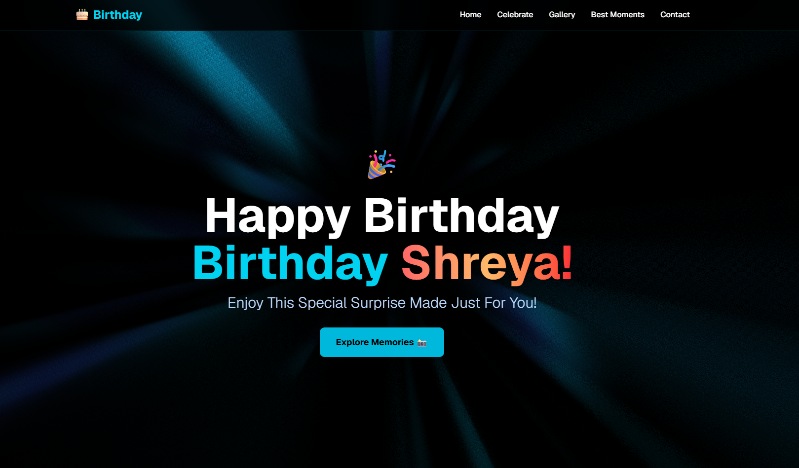

# CelebrationHub

A birthday website you make for one person: their photographs in a 3D dome, a letter that stays sealed until the day, a wish wall their friends write to, and an invite you can share on WhatsApp.



## What it does

- **Photographs** in a drag-to-turn 3D dome, served resized so the page stays light on a phone
- **A letter** that opens at midnight on the birthday, in their timezone, with a countdown before
- **A wish wall** where guests leave a message and a photo; you approve each one before it appears
- **Celebrate** page with music and paper confetti
- **Best moments**, a short ruled list of the moments worth keeping
- **An invite page** with its own share card

## Stack

Next.js 16 (App Router) · React 19 · Tailwind CSS 4 · Upstash Redis (REST) · Vercel Blob · Jest and Testing Library · TypeScript

## Getting started

```bash
npm install
cp .env.example .env.local   # optional: the site runs without it
npm run dev                  # http://localhost:3000
```

Without the environment variables, everything works except the wish wall, which stays hidden while the form says it is not connected.

## Make it yours

| What | Where |
| --- | --- |
| Names, dates, navigation, every line of copy | `lib/siteConfig.ts` |
| The letter | `lib/letter.ts` (kept apart so it never ships before the day) |
| When the letter opens | `birthday.unlockISO` and `birthday.utcOffset` in `lib/siteConfig.ts` |
| Photographs | `public/data/pic/1.jpg` to `23.jpg`, same names |
| Music | `public/data/music/1.mp3` |
| Colours, type, spacing | `app/tokens.css` (one set of tokens) and `app/globals.css` |

## Turning on the wish wall

1. In Vercel, open the project, then **Storage**:
   - add **Upstash for Redis** from the Marketplace, which sets `KV_REST_API_URL` and `KV_REST_API_TOKEN`;
   - create a **Blob** store, which sets `BLOB_READ_WRITE_TOKEN`.
2. Add `ADMIN_TOKEN` in **Settings > Environment Variables**: 24 characters or more, for example the output of `openssl rand -base64 32`.
3. Redeploy. Wishes appear in `/admin`; open it, paste your key, and put each one on the wall.

## Scripts

| Command | Does |
| --- | --- |
| `npm run dev` | development server |
| `npm run build` | production build |
| `npm start` | serve the build |
| `npm run lint` | ESLint |
| `npm test` | Jest (unit and API route tests) |

## Project structure

```
app/
  page.tsx                 home: index of the gift, the dome, the letter, the wish wall
  celebrate/ best-moments/ contact/ love-letter/ invite/ admin/
  api/wishes/              public: send a wish, read the wall
  api/admin/wishes/        owner: list, approve, delete
  tokens.css base.css globals.css
components/                sections and pieces (print, wish-wall, countdown, dome-gallery …)
lib/
  siteConfig.ts            all copy and settings
  letter.ts                the letter, server only
  birthday.ts              unlock time and countdown
  wishes.ts redis.ts       validation, rate limits and storage
docs/ARCHITECTURE.md       how it fits together, and the security model
```

How the pieces connect, the data model and the security controls are in [docs/ARCHITECTURE.md](docs/ARCHITECTURE.md).
